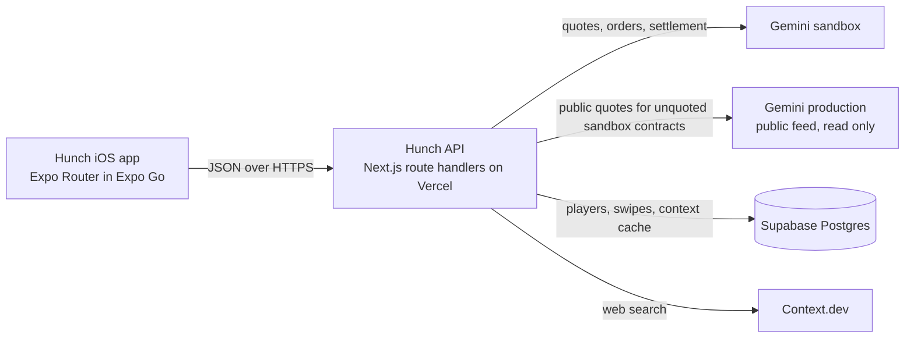

# Hunch

Hunch is an iPhone app where you call live prediction markets blind, then see what the market thinks. Each paid swipe places a real $1 limit order on Gemini's sandbox exchange, and Edge points reward the calls that beat the market.

Built on Gemini Prediction Markets. Context by Context.dev.

Source: https://github.com/Vibhor0409/hunch. Note: the leaderboard holds 14 seeded demo players (see docs/SEED.md); the Players and Calls counters include them. API: https://hunch-api.vercel.app.

## Try it on your iPhone

1. Install Expo Go from the App Store.
2. Point the iPhone camera at this QR code, or open the link below on the phone.
3. Type a name and start swiping. There is no account to create.


Link: https://qr.expo.dev/eas-update?projectId=04129f71-6fe6-470b-85b7-d02fb1ed73ff&runtimeVersion=exposdk:57.0.0&channel=preview

The app ships as an EAS Update on the `preview` channel with runtime `exposdk:57.0.0`, which is the runtime Expo Go uses, so there is nothing to build or sideload. The API it talks to runs at https://hunch-api.vercel.app.

## How it works

Every card is a live market from Gemini's prediction API. The card shows the question, a category and the time to close. It never shows a price or a percentage. Swipe right for YES, left for NO, or up to skip. The three buttons under the card do the same. Lanes at the top filter by time to close: Live (within 60 minutes), Tomorrow (within 48 hours), This week (within 7 days) and For you (a mix, with every third card from Live).

Blind means blind. The feed payload contains no prices, so the app cannot leak them. Odds come back only in the response to your swipe.

After a swipe the reveal sheet springs in with the YES and NO percentages, the share of the market that sided with you, what your stake returns if you are right, and a receipt for the order.

### The $1 sandbox order

On a paid swipe the server re-reads the current price and places one limit buy on the Gemini sandbox: `orderType: "limit"`, `side: "buy"`, `outcome` set to your side, `price` set to the current buy price of that side, `quantity` equal to stake divided by price and floored to 0.01 contracts, `timeInForce: "immediate-or-cancel"`. A $1 stake at 0.74 buys 1.35 contracts and costs at most $1. The receipt shows the order id, status, contracts and price, tagged "Live order on Gemini sandbox". If the order does not fill, the app says "No fill at this price. Scored as practice." and the swipe counts as practice. The sandbox trades test dollars, so no real money moves.

### Edge

Edge measures how much you beat the market, not just whether you were right. With p the price of your chosen side at swipe time:

| Result | Edge |
| --- | --- |
| Right | +10 x (1 - p) |
| Wrong | -10 x p |

A right call at 0.20 earns 8.0 Edge. A right call at 0.90 earns 1.0. A wrong call at 0.90 costs 9.0. Edge is stored with one decimal. Practice swipes score Edge too, so you keep playing after the daily cap.

### Settlement

Settlement is lazy. The app calls `POST /api/settle` on launch, when it returns to the foreground, and when the Leaderboard or Me tab opens. The server reads the settled contract from Gemini, compares its `resolutionSide` with your call, and writes the result. Payout for a paid winning call is contracts x $1; profit is payout minus cost. Newly settled rows are highlighted in Recent calls on the Me tab.

### Earned limits

Your level sets how many paid swipes you get per day and the stake on each. Positive Edge unlocks more.

| Level | Paid swipes per day | Stake per swipe | Unlocks when |
| --- | --- | --- | --- |
| 1 | 10 | $1 | Start |
| 2 | 15 | $2 | At least 10 settled calls and average Edge above 0 |
| 3 | 20 | $3 | At least 25 settled calls and average Edge of 0.5 or more |
| 4 (ceiling) | 25 | $5 | At least 50 settled calls and average Edge of 1.0 or more |

Settled calls include practice swipes. A player drops one level when total Edge over their last 10 settled calls is negative. "Today" is the calendar day in America/Los_Angeles. The Me tab shows a level bar with progress to the next level and the rule "Lose your edge, lose the level."

## Live context by Context.dev

Each card has a small Context button. Tapping it flips the card to its back, which shows two to three lines of live context from the web about the market's question, the source name, a "Read more" link that opens in the in-app browser, and the line "Context by Context.dev". A Back button flips it again.

The server fetches context with `POST /web/search` on the Context.dev API, using the card's question plus "latest news" as the query, with highlights on and freshness set by lane (last 24 hours for Live, last week otherwise). It keeps the first highlight of the best result, trimmed to whole sentences and at most 220 characters.

Blind still means blind here. The server drops any sentence that mentions odds, bettors, sportsbooks, implied probability, "traders give", or a prediction market or sportsbook by name, and the query excludes those domains. Ordinary facts with numbers, like a forecaster's chance of rain or a poll result, are allowed. No odds reach the phone before the reveal.

Context loads only when someone taps the button, and the result is cached in the `card_context` table for everyone: 30 minutes for Live markets, 6 hours otherwise. The cache key is the event's series when there is one, so all BTC 5-minute markets share one entry. Markets with no result are cached as empty for 30 minutes so they are not searched again and again. A lookup costs about 2 credits, so credits are spent once per market, not once per user.

A credit guard in the `context_usage` table skips the call when the day's spend passes `CONTEXT_DEV_DAILY_CREDIT_CAP` (default 400) or the last reported balance is under 50 credits. When context is unavailable for any reason, the back says "No fresh context for this one. Trust your gut." and the swipe still works.

## Architecture

Hunch is an app and a headless API. There is no web UI. The API exists because the Gemini secret must never ship inside the app; the phone knows only `EXPO_PUBLIC_API_URL`.



The app is Expo SDK 57 with Expo Router, TypeScript strict, Reanimated and Gesture Handler for the swipe deck and the reveal, and AsyncStorage for the player id. It runs in Expo Go and is published with EAS Update.

The API is Next.js used only for route handlers, on Vercel's Node runtime. It holds the Gemini, Supabase and Context.dev keys and talks to Gemini through `@gemini-markets/sdk`.

The database is Supabase Postgres, provisioned through the Vercel Marketplace. Tables `players` and `swipes` and the `leaderboard` view are in `supabase/schema.sql`; `card_context` and `context_usage` are in `supabase/context.sql`. Row level security is on with no policies, so only the server's service role can read or write.

| Route | Does |
| --- | --- |
| `POST /api/join` | Creates a player from a name; 409 if the name is taken |
| `GET /api/feed?lane=&playerId=` | Up to 20 cards for a lane, with no prices, minus contracts already swiped |
| `POST /api/swipe` | Re-reads the price, decides paid or practice, places the order, stores the swipe, returns the reveal |
| `POST /api/settle` | Settles expired swipes and scores Edge |
| `GET /api/leaderboard` | Ranked players and the counters (players, calls, Gemini orders) from the database |
| `GET /api/profile?playerId=` | Level, progress, Edge by category and the last 10 calls |
| `GET /api/context?eventTicker=&instrumentSymbol=&playerId=` | Cached or fresh context for one card |

Repository layout: `mobile/` (the app), `server/` (the API), `supabase/` (SQL), `contracts/` (shared TypeScript types, copied into both), `docs/` (spec, verified API facts, raw samples), `video/` (the demo video), `scripts/` (release).

## Gemini SDK calls

Every Gemini call goes through `server/lib/gemini/`, using `@gemini-markets/sdk` 0.1.1 (server entry, HMAC auth, REST only). Reads use unauthenticated clients so the feed keeps working even if the trading key is rejected; only orders use the authenticated sandbox client.

| Method | Where | Used for |
| --- | --- | --- |
| `listEvents({ status: ["active"], limit: 500, offset })` | feed, quote fallback | Every active event with its contracts and buy prices |
| `getEvent({ eventTicker })` | quote, settlement | A fresh price right before an order; `contracts[].resolutionSide` once the contract or event is `settled` |
| `listRecentlySettledEvents({ limit: 500 })` | settlement fallback | Finding a settled event when `getEvent` answers 404 |
| `placeOrder({ symbol, orderType, side, quantity, price, outcome, timeInForce, makerOrCancel })` | swipe | One limit buy per paid swipe, never retried |
| `getEventStrike`, `getPredictionMarketsTermsStatus`, `acceptTerms` | `server/scripts/gemini-smoke.ts` only | Checking the strike shape, and accepting the sandbox terms once after the human confirms |

Card text is built only from `event.title`, `contract.label` and the reference strike. A single Up contract with a strike reads "BTC price today at 6:15pm EDT: Up from $83,515.78?"; a ladder contract reads "BTC price today at 7pm EDT: $83,100 or above?".

### Hybrid feed rule

The sandbox lists around 90 active events but quotes only about 37 contracts, nearly all closing within the hour, so lanes beyond Live would be empty. The production API, read without authentication, quotes about 4,200 contracts, and 234 of them share an `instrumentSymbol` with an open sandbox contract. The feed therefore works in this order:

1. A contract the sandbox quotes uses sandbox prices.
2. An open sandbox contract the sandbox does not quote takes the prices of its production copy.
3. Orders always go to the sandbox. An immediate-or-cancel with no sandbox liquidity cancels, and the swipe is scored as practice with the receipt kept.

Settlement reads the sandbox first and production as a second reading of the same result, since both settle the same tickers from the same index. The sandbox is served by replicas that disagree, so the feed issues three parallel listings and merges them by ticker, and `getEvent` is retried three times before a 404 is believed. Details and raw samples are in `docs/GEMINI_API.md` and `docs/samples/`.

## Run locally

You need Node 22.4 or newer, npm, and Expo Go on a phone on the same Wi-Fi as your laptop.

Create `server/.env.local` with these names (values come from your own accounts; never commit them):

```
GEMINI_API_KEY=
GEMINI_API_SECRET=
SUPABASE_URL=
SUPABASE_SERVICE_ROLE_KEY=
CONTEXT_DEV_API_KEY=
CONTEXT_DEV_DAILY_CREDIT_CAP=400
```

The Gemini key must be a sandbox key for the primary account with Trading enabled, created at https://exchange.sandbox.gemini.com. A master key is rejected by the prediction endpoints. Apply `supabase/schema.sql` and `supabase/context.sql` to your Supabase project.

```sh
npm --prefix server install
npm --prefix server run dev          # http://localhost:3000, "/" answers "Hunch API"
npx --prefix server tsx server/scripts/gemini-smoke.ts   # checks the SDK against live sandbox data
```

Create `mobile/.env` with `EXPO_PUBLIC_API_URL=http://<your-lan-ip>:3000`, then:

```sh
cd mobile
npm install
npx expo start        # add --tunnel if the phone is on another network
```

Scan the QR code in the terminal with Expo Go. Checks: `npm --prefix server run typecheck`, `npm --prefix server run test`, `npm --prefix mobile run typecheck`, and `cd mobile && npx expo-doctor`.

To publish a new version for Expo Go, run `scripts/release.sh <production-api-url> "<message>"`. It writes the API URL into `mobile/.env`, publishes an EAS Update on the `preview` channel for iOS, and prints the QR link.

## Responsible design

Paid swipes are capped per day by level, starting at 10. Past the cap the deck switches to practice mode, which still scores Edge, so the game never pushes you to spend more to keep playing. Stakes are test dollars on Gemini's sandbox; no real money is involved. Edge is a score, not a currency. There are no coins and nothing to cash out. You call every market before you see its odds, so the app cannot steer you toward the favorite. Joining takes a name and nothing else.

## Credits

Built on Gemini Prediction Markets. Context by Context.dev. Hunch is an independent hackathon project and is not affiliated with Gemini or Context.dev.

Built in one afternoon at B@BHacks 2.0 by one person with Claude Code.
